# novel-tts

小說 AI 分析 + TTS 語音合成系統。輸入小說純文字，AI 分解成「角色 × 段落」，
再呼叫 OpenRouter 的 TTS 模型逐段發聲，輸出每段音檔、章節合併檔與整本 ZIP。

**不用註冊、也不用登入。** 打開就能用 —— 你的小說、角色與音檔都存在你自己的
瀏覽器裡，伺服器只做無狀態的 AI 運算，不保存你的任何資料。OpenRouter API Key
由你自己提供。

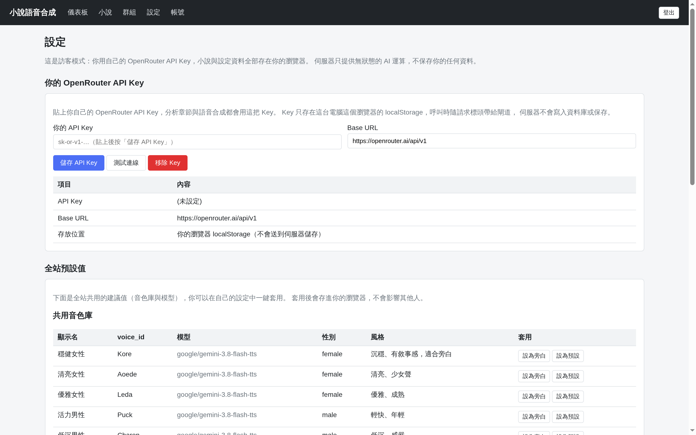

## 使用說明

完整的圖文操作說明在網站上：**[/guide](/guide)**（免登入即可瀏覽）。

涵蓋：設定 API Key → 匯入小說 → AI 分析 → 語音合成 → 調整角色音色 →
用群組讓音色跨集一致 → 合併下載 → 資料存在哪與如何備份，以及常見問題。

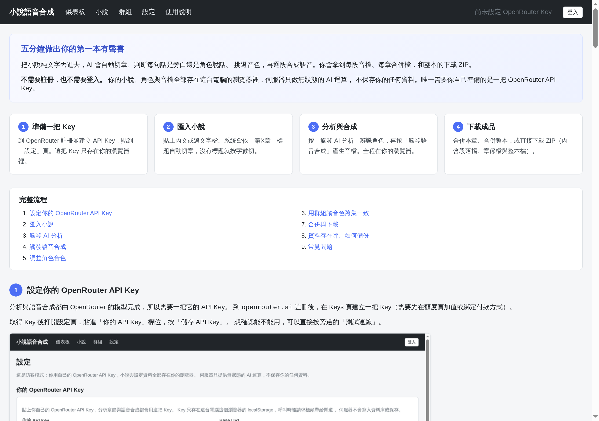

## 這系統在做什麼

```
小說純文字（存在你的瀏覽器）
   ↓  AI 分析（chat/completions，經由無狀態閘道）
切章 → 逐段判定「旁白 / 哪個角色說話」→ 抽出情緒與語氣
   ↓  音色指派（群組共用音色優先，否則手動指定）
每個角色固定一個 voice_id + TTS 語氣指令
   ↓  TTS 合成（audio/speech，multi-speaker 一次請求多 turn）
段落音檔 → 章節合併 → 整本合併 → ZIP 匯出
        ↓  全部存回你的瀏覽器（IndexedDB）
```

### 訪客模式：不需要帳密，資料留在你的瀏覽器

打開網址就能用，不用註冊、也不用登入。

| 資料 | 放在哪 |
|---|---|
| 小說內文、章節、角色、段落 | 你的瀏覽器 IndexedDB |
| 音檔（MP3） | 你的瀏覽器 IndexedDB（Blob） |
| 群組設定、音色指派 | 你的瀏覽器 IndexedDB |
| OpenRouter API Key | 你的瀏覽器 localStorage |
| 伺服器 | **不保存你的任何資料**，只做無狀態的 AI 運算 |

伺服器這邊只有三件事是「全站共用」的預設值：音色庫、模型清單、模型定價。
它們是建議值，你可以一鍵套用到自己的設定，也可以完全不用。

**AI 運算怎麼在伺服器跑，資料卻不留下來？**

瀏覽器把你的 Key 放在 `X-OpenRouter-Key` 標頭送給閘道，伺服器只在**那一次請求**
的記憶體裡用它去呼叫 OpenRouter，然後把結果回傳。它不寫資料庫、不落盤、
不記到 log 裡 —— 這點有實測過：容器 log 中 `sk-or-v1` 出現 0 次。

```
瀏覽器                        伺服器（無狀態）              OpenRouter
  │                              │                          │
  │  POST /api/gateway/analyze   │                          │
  │  X-OpenRouter-Key: sk-...    │                          │
  │ ───────────────────────────> │ ── chat/completions ───> │
  │                              │ <── 段落 JSON ────────── │
  │ <─────────────────────────── │                          │
  │  （結果寫進 IndexedDB）      │  ← 不保留任何東西        │
```

伺服器仍需要 ffmpeg 做 PCM→MP3 轉檔與音檔合併，所以這兩步放在伺服器端，
但同樣是無狀態的：收位元組、合併、回傳，不留檔案。瀏覽器不需要載入
30MB 的 ffmpeg.wasm。

**公開服務的保護**

- 每個 IP 每分鐘最多 30 次閘道呼叫，超過回 429（以 Cloudflare 傳來的
  `CF-Connecting-IP` 為準，不信任可以偽造的 `X-Forwarded-For`）
- 寫入型 API（`/api/novels`、`/api/groups` 等）仍然需要登入
- 訪客模式的頁面不查資料庫 —— 就算登入後的管理資料存在 DB，也不會被渲染給訪客

**想跨裝置續用？**

登入帳號模式（選用）會把作品存到伺服器資料庫，可以跨裝置使用。
但目前訪客模式的資料不會自動同步到帳號 —— 兩邊是各自獨立的。

### 小說群組：讓音色跨集一致

同一本連載小說常常分好幾十集慢慢出版。每一集單獨分析會得到不同的角色音色，
聽起來像換了配音員。**群組**（`/groups`）解決這件事：

- 群組層級維護共用角色（名稱、別名、音色、語氣）與群組旁白音色
- 各集分析時自動比對名稱與別名，命中就套用群組的音色與語氣指令
- 各集仍保留自己的章節、段落與本集特有角色 metadata

實測同一角色跨集音色一致：

| 集數 | 角色 | 套用音色 | 套用語氣 |
|---|---|---|---|
| 燈火重亮 第一集 | 林晚 | Aoede | 語氣清冷，語速偏慢 |
| 燈火重亮 第一集 | 陳硯 | Charon | 語氣低沉，話少，帶點冷幽默 |
| 燈火重亮 第二集 | 陳硯 | Charon | 語氣低沉，話少，帶點冷幽默 |

> 語氣指令的影響實測（同一 voice ID，量測音量與時長的變異率）：
> 無 instructions 時音量變異 9.3%、時長變異 6.2%；
> 有 instructions 時音量變異降到 1.2%、時長變異 4.7% —— 約 3.5 倍改善。
> 語氣指令是跨集音色一致性的關鍵，不是裝飾。

## 技術棧

| 項目 | 版本／選擇 |
|---|---|
| Spring Boot | 4.1.2 |
| JDK | 25 |
| 資料庫 | PostgreSQL 17（Podman 容器） |
| ORM / 遷移 | Spring Data JPA + Flyway |
| AI | OpenRouter（分析 `/api/v1/chat/completions`、合成 `/api/v1/audio/speech`） |
| TTS 模型 | `google/gemini-3.8-flash-tts`（multi-speaker，輸出 PCM，ffmpeg 轉 MP3） |
| 前端 | Thymeleaf + Spring Security（Session-based） |

## 規格文件

實作前先看 `spec/`：

| 文件 | 內容 |
|---|---|
| [spec/00-專案規格總覽.md](spec/00-專案規格總覽.md) | 目標、架構、技術決策、開發順序 |
| [spec/01-資料庫schema.md](spec/01-資料庫schema.md) | 完整 DDL、欄位語意、索引 |
| [spec/02-AI-Prompt契約.md](spec/02-AI-Prompt契約.md) | Prompt 全文、JSON schema、TTS 請求格式、分組策略 |
| [spec/03-API與頁面清單.md](spec/03-API與頁面清單.md) | REST API、頁面、設定鍵 |

## 實際部署

正式部署用另一套 compose（與開發版資料、容器、volume 完全隔離）：

```bash
cd WebEnv
cp .env.example.prod .env.prod
# 填入 POSTGRES_PASSWORD 與 NOVELTTS_MASTER_KEY
podman-compose -f docker-compose.prod.yaml --env-file .env.prod up -d
```

> ⚠️ 必須用 `-f` 指定檔名。`podman-compose` 會把目錄下所有存在的 compose 檔
> 依序合併，不指定就會把開發版與部署版的設定混在一起。

部署版的差異：密碼強制必填（無預設值）、根檔案系統唯讀、`no-new-privileges`、
資源調校、log 輪轉加大。

完整步驟、首次設定流程與疑難排解見 **[WebEnv/DEPLOY.md](WebEnv/DEPLOY.md)**。

## 本機環境

### 容器：本機沒有 Docker daemon，用 Podman

```bash
# 先建應用程式映像（含 ffmpeg，TTS 回傳 PCM 必須轉 MP3）
podman build -t noveltts-app:local -f Dockerfile .

cd WebEnv

# 先複製環境變數並填入 master key
cp .env.example .env
echo "NOVELTTS_MASTER_KEY=$(cat ~/.noveltts-master-key)" >> .env

# 啟動 PostgreSQL + 應用程式（podman-compose 1.3.0 需要在 compose 檔所在目錄執行）
podman-compose up -d

# 查看狀態
podman ps

# 進入 psql
podman exec -it noveltts-pg psql -U noveltts -d noveltts

# 查看應用程式記錄
podman logs -f noveltts-app

# 停止
podman-compose down
```

> ⚠ `podman-compose up -d --force-recreate` 會重建容器並重跑 Flyway。
> 開發時請改用 `podman restart noveltts-app` 快速重啟，避免反覆重建 866MB 的映像。
>
> 兩種啟動方式擇一：
> - **容器模式**（`podman-compose up -d`）：app 跑在容器內，連容器網路的 postgres
> - **本機模式**：只啟 postgres，用 `java -jar web/target/web.jar` 在本機跑 app

> `WebEnv/docker-compose.yaml` 寫成標準格式，搬到有 Docker 的環境直接 `docker compose up -d` 即可。
> 本機一律用 `podman-compose`。

### 環境變數

| 變數 | 用途 | 預設 |
|---|---|---|
| `DB_HOST` / `DB_PORT` / `DB_NAME` | PostgreSQL 連線 | `127.0.0.1` / `5432` / `noveltts` |
| `DB_USER` / `DB_PASSWORD` | PostgreSQL 帳密 | `noveltts` / `noveltts_dev_pwd` |
| `NOVELTTS_MASTER_KEY` | **API Key 加密主金鑰（必填，base64 32 bytes）** | 無 |
| `NOVELTTS_STORAGE_ROOT` | 音檔根目錄 | `./storage` |
| `SERVER_PORT` | HTTP port | `8090`（8080 已被 nextcloud 容器占用） |
| `NOVELTTS_ADMIN_USERNAME` / `_PASSWORD` | 管理介面帳密 | `admin` / `admin` |

> ⚠ **主金鑰必須跨重啟固定**。主金鑰一變，已加密的 API Key 就無法解密（Tag mismatch）。
> 產生後請保存，例如：
> ```bash
> openssl rand -base64 32 > ~/.noveltts-master-key
> export NOVELTTS_MASTER_KEY=$(cat ~/.noveltts-master-key)
> ```

### 建置與執行

```bash
# 建置
mvn -pl app,web -am clean package

# 執行
java -jar web/target/web-*.jar
```

或開發模式：

```bash
mvn -pl web spring-boot:run
```

開啟 http://localhost:8080 ，以設定頁（`/settings`）填入 OpenRouter API Key 與模型。

### 介面截圖

以下截圖取自實際部署環境，資料由真實 OpenRouter（`google/gemini-3-flash-preview` +
`google/gemini-3.8-flash-tts`）產生，非 mock。

#### 訪客模式的設定頁

不用登入就能用。填入你自己的 OpenRouter API Key —— 這把 Key 只存在你的瀏覽器
localStorage，伺服器不會保存。畫面下方是全站共用的音色庫與模型建議值，
可以一鍵套用到自己的設定。


#### 訪客模式的小說詳情

匯入小說 → 觸發 AI 分析 → 觸發語音合成 → 章節合併 → 下載 ZIP，
全程都在瀏覽器完成。章節與音檔列表可以直接試聽。

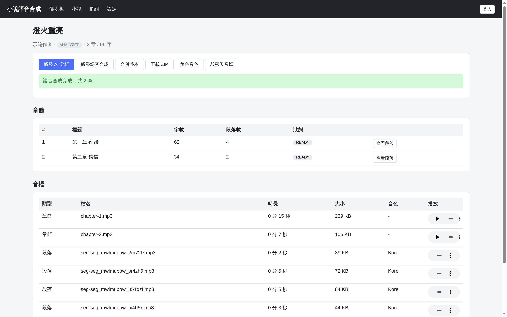

#### 儀表板（帳號模式）

作業進度、音檔數量與最近執行紀錄。

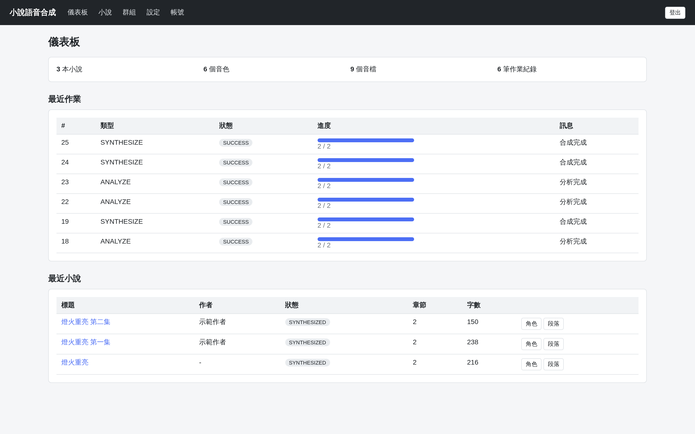

#### 小說列表

匯入時可指定所屬群組與集數順序；列表會標示每集屬於哪個群組。

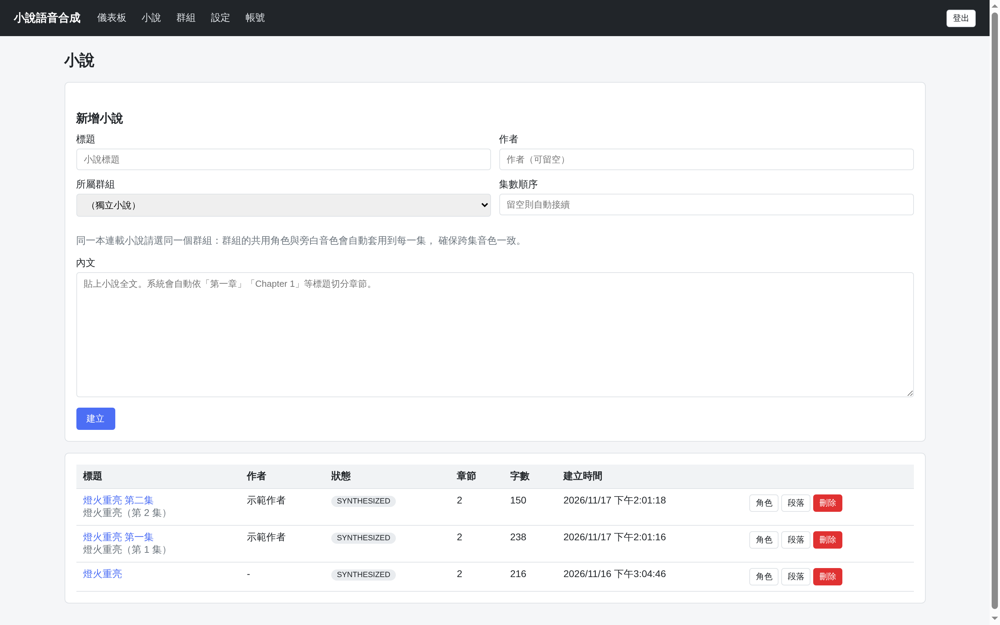

#### 小說詳情

章節狀態、各類音檔（段落 / 章節 / 整本）的時長與大小，可直接試聽。

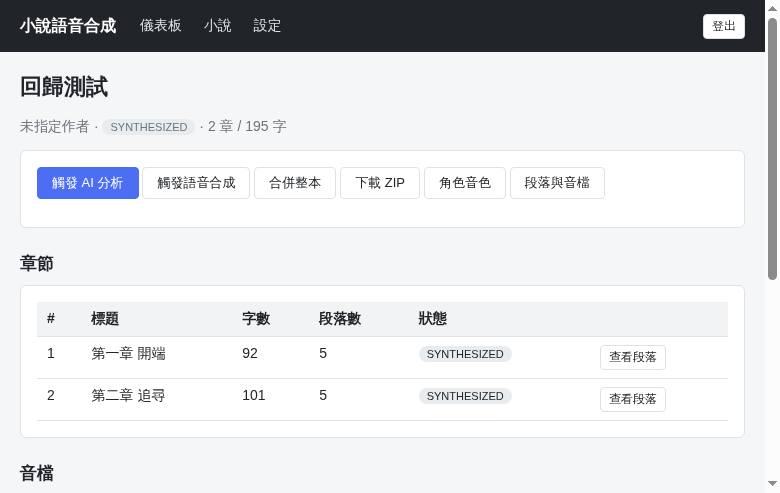

#### 小說群組

群組維護跨集共用的角色音色與旁白音色。

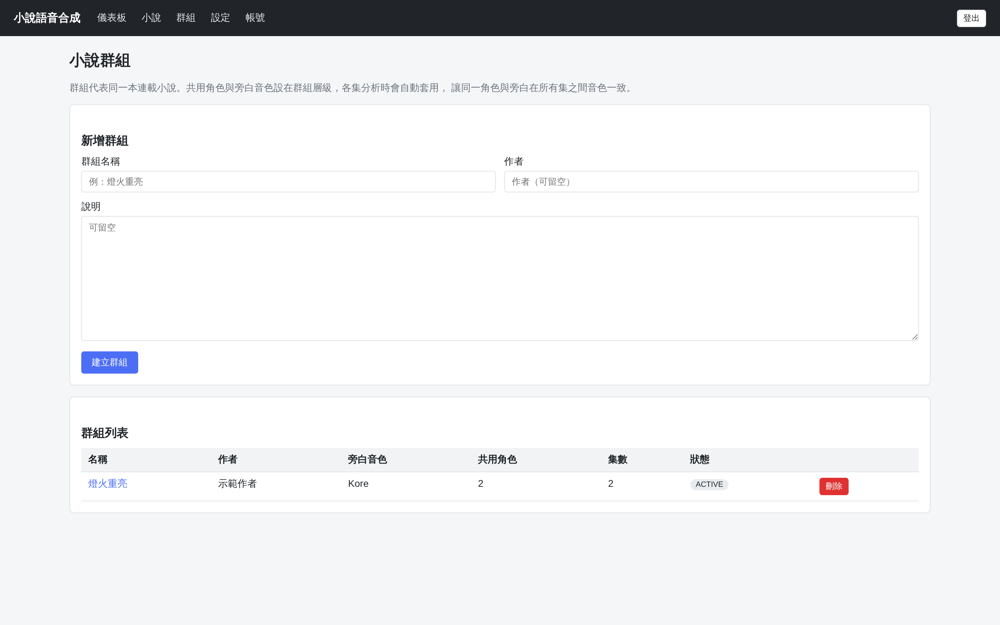

展開群組後，可設定共用角色（別名用於比對各集的角色名）：

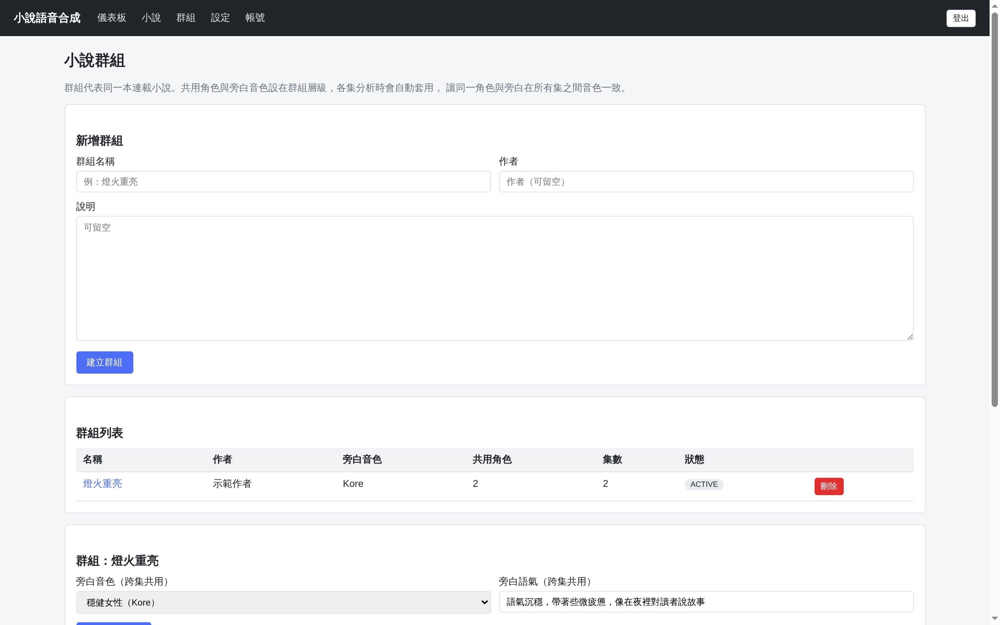

#### 角色音色

為每個角色挑音色並設定專屬語氣指令。

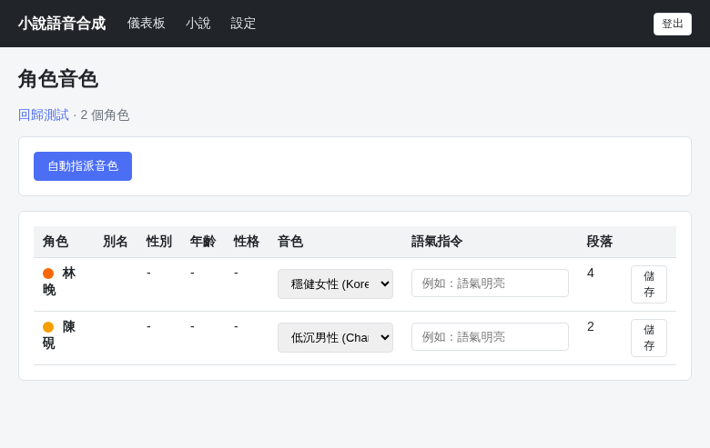

#### 段落與音檔

逐段檢視判定結果：類型（旁白 / 對話）、說話者、情緒、語氣、實際使用的音色。

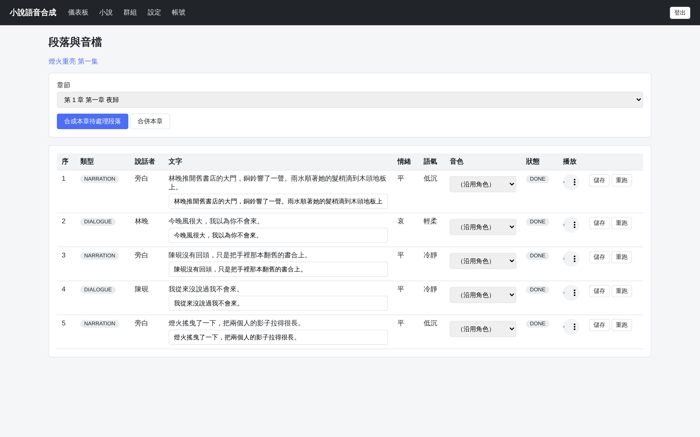

#### 設定

帳號模式下的設定：Provider（API Key 以 AES-GCM 加密落庫，畫面僅顯示遮蔽值）、
模型、備援模型、音色庫。訪客模式則是把你自己的 Key 存在瀏覽器，見上方截圖。

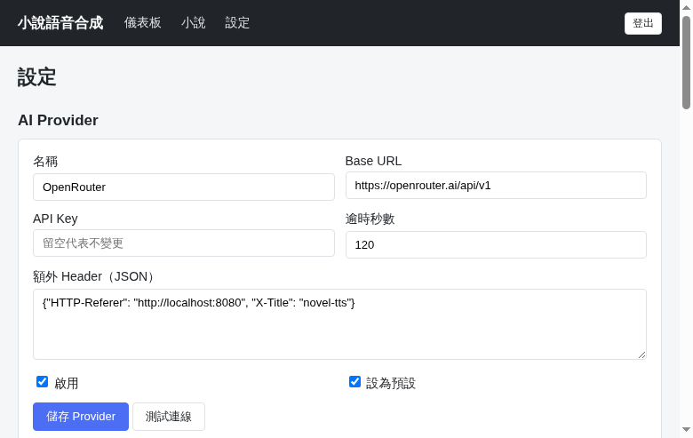

### 音檔輸出

預設落在 `./storage/novel/{novelId}/`，可由 `NOVELTTS_STORAGE_ROOT` 覆寫。
輸出三種：`SEGMENT`（每組段落音檔）、`CHAPTER`（章節合併）、`BOOK`（整本合併），
以及整本 ZIP 匯出（`/api/novels/{id}/export`）。

### 測試

```bash
mvn test    # 66 個單元測試（app 51 + web 15）
```

前端另有三套整合測試（Node + fake-indexeddb，直接載入實際部署的 JS 檔）：

```bash
cd tools/gateway-test

# 離線驗證 pipeline 邏輯（stub fetch，不呼叫 OpenRouter）
node pipeline-test.js

# 端到端：資料層 + 閘道 + 真實 OpenRouter
OPENROUTER_API_KEY=sk-or-v1-... node test.js
OPENROUTER_API_KEY=sk-or-v1-... node full-pipeline-test.js
```

`full-pipeline-test.js` 會實際跑完整條線：切章 → 分析 → 角色 → 群組音色 →
合成 → 合併本章 → 合併整本 → ZIP，並驗證匯出資料不含 API Key。

### 端到端驗證（不需真實 API Key）

`tools/mock_openrouter.py` 是一個假的 OpenRouter 伺服器，會依 spec/02 的契約
回傳分析 JSON 與真實 PCM 音訊，用來驗證完整鏈路：

```bash
# 1) 啟動 mock（與 app 同一個 podman 網路）
podman run -d --name nt-mock --network webenv_default \
  -v $PWD/tools/mock_openrouter.py:/mock.py:ro \
  docker.io/library/python:3.13-alpine python /mock.py --port 18080

# 2) 把 provider 的 base_url 指向 mock
podman exec noveltts-pg psql -U noveltts -d noveltts \
  -c "update ai_provider_config set base_url='http://nt-mock:18080/api/v1';"

# 3) 走完整流程：小說 → 分析 → 指派音色 → 合成 → 章節合併 → 整本合併 → ZIP
```

驗證後記得把 base_url 改回 `https://openrouter.ai/api/v1`，
或直接在設定頁 `/settings` 填入真實 API Key。

涵蓋範圍：

| 測試類 | 驗證內容 |
|---|---|
| `ChapterSplitterTest` | 中/英文章節標題切分、無標題時依字數切分 |
| `SegmentParserTest` | AI 回應解析、markdown 圍欄、雜訊擷取、各種非法輸入的錯誤處理 |
| `TtsGroupBuilderTest` | 依「說話者」切 turn、字數上限分組、旁白音色、語氣合併 |
| `CryptoServiceTest` | API Key 加密解密、密文隨機性、換金鑰無法解密、遮蔽格式 |
| `AudioToolTest` | PCM→MP3 轉檔、時長量測、MP3 合併（需 ffmpeg） |
| `TtsRequestTest` | 送給 OpenRouter 的 TTS 請求 JSON 格式 |
| `ExportServiceTest` | ZIP 匯出的目錄結構與缺檔處理 |

### 已驗證的端到端結果

以 mock OpenRouter 實測完整鏈路：

```
小說 2 章 → 分析出 10 段落（旁白 4 / 對話 6）→ 自動建立 2 個角色
→ 指派音色（林晚→Kore、陳硯→Charon）→ 合成 10/10 段落 DONE
→ 每章 1 個音檔（multi-speaker 一次請求含多個 turn）
→ 章節合併檔 8s → 整本合併檔 16.064s → ZIP 5 檔案
```

## 資料庫遷移

Flyway 遷移檔在 `db/migration/`，由 `app` 模組執行：

```
db/migration/V1__init_schema.sql
```

本機開發時 `spring.flyway.locations` 指向該目錄；打包時複製進 jar 的 `classpath:db/migration`。


## 對外服務（Cloudflare Tunnel）

用 Cloudflare named tunnel 對外服務。對外網址由你在 Cloudflare 後台指定，
本專案不綁定特定網域，以下範例以 `<your-domain>` 表示。

```
https://<your-domain>
```

### 啟動 tunnel（systemd user service）

已建立 `~/.config/systemd/user/cloudflared-noveltts.service`，用 podman 跑新版
cloudflared（2026.11.0），開機自動啟動、崩潰自動重啟。

```bash
systemctl --user status  cloudflared-noveltts.service
systemctl --user restart cloudflared-noveltts.service
systemctl --user disable --now cloudflared-noveltts.service
```

`loginctl enable-linger eric` 已啟用，登出後服務仍持續運作。

#### 為什麼用容器而不是系統套件

系統的 cloudflared 是 2026.5.0，實測 QUIC 連線會被遠端 edge 週期性踢掉：

```
ERR failed to accept incoming stream requests
    error="failed to accept QUIC stream: Application error 0x0 (remote)" connIndex=2
```

每 5 分鐘左右發生一次，cloudflared 會自動重連所以服務不中斷，但連線會反覆重建。
新版 2026.11.0 觀察 15 分鐘零 ERR，且連到不同的 edge IP。

注意 rootless podman 的容器 uid 映射：容器內非 root（uid 65532）讀不到 host 上
700 權限的 `~/.cloudflared`。解法是 `--user 0:0`（rootless 會把容器 root
映射到 host 的 eric）。

```bash
# 以自己的 home 目錄替換 $HOME
podman run --rm --network host --user 0:0 --name cf-noveltts \
  -v $HOME/.cloudflared:$HOME/.cloudflared:ro \
  -e HOME=$HOME \
  -e TUNNEL_ORIGIN_CERT=$HOME/.cloudflared/cert.pem \
  docker.io/cloudflare/cloudflared:2026.11.0 tunnel \
  --config $HOME/.cloudflared/config-noveltts.yml --no-autoupdate run <tunnel-name>
```

> 路徑與 tunnel 名稱請換成你自己的。`<tunnel-name>` 為你在
> `cloudflared tunnel create` 時指定的名稱。

`--network host` 是必要的：容器內的 `localhost` 指的是容器自己而非 host，
用 bridge 網路時 origin 必須改用 `host.containers.internal`。

設定檔 `~/.cloudflared/config-noveltts.yml`：

```yaml
# tunnel 與 credentials 檔名由 Cloudflare 產生，請填你自己的
tunnel: <tunnel-uuid>
credentials-file: <home>/.cloudflared/<tunnel-uuid>.json

ingress:
  - hostname: <your-domain>
    service: http://localhost:8090
  - service: http_status:404
```

### 反向代理的 HTTPS 處理

經 tunnel 存取時，cloudflared 會送 `X-Forwarded-Proto: https`，但容器預設不信任這些標頭，
會導致 redirect 退回 `http://`（HTTPS 降級）與 session cookie 缺少 secure 旗標。

處理方式（見 `SecurityConfig` 與 `application.yml`）：

1. **明確註冊 `ForwardedHeaderFilter`** 並設為 `Ordered.HIGHEST_PRECEDENCE`。
   用單純 `@Bean Filter` 不夠 —— Boot 會以 `LOWEST_PRECEDENCE` 註冊，
   排在 Spring Security filter chain（order = -100）之後，
   導致 login redirect 產生當下 request 尚未包裝 forwarded 標頭。
2. `server.forwarded-headers-strategy: none` —— 已自行註冊 filter，避免與容器原生處理重複。
3. **session cookie 設定在 `server.servlet.session.cookie.*`**。
   Spring Boot 4 已把路徑從 `spring.servlet.session.cookie.*` 改到 `server.servlet.session.cookie.*`，
   寫錯前綴會靜默失效（HttpOnly 會套用但 Secure / SameSite 不會）。
4. `server.servlet.session.cookie.secure` 預設 true；本機以 http 直連時可設
   `SERVER_SESSION_COOKIE_SECURE=false`。

### 注意

- tunnel 是 named tunnel，重新啟動後網址不變（quick tunnel 每次都會換）。
- 應用仍只綁 `127.0.0.1:8090`，不直接對外開放。


## 管理帳號

帳號改由資料庫管理（`app_user` 表），密碼以 **BCrypt 雜湊**儲存，不保留明文。

- 初始帳號：`admin` / `admin`（V4 migration 種子資料）
- `must_change_password = true`，因此**首次登入會被強制導向變更密碼頁**，
  變更前無法存取其他頁面
- 變更密碼頁：`/do-change-password`（GET 顯示表單、POST 提交都用這一個路徑），
  也可從各頁右上角「帳號」進入
- 新密碼至少 8 個字元，且不可與目前密碼相同
- `NOVELTTS_ADMIN_USERNAME` / `NOVELTTS_ADMIN_PASSWORD` 環境變數已移除

### 實作要點

**循環依賴**：`SecurityConfig` → `MustChangePasswordFilter` → `AccountService` →
`PasswordEncoder` → `SecurityConfig`。解法是把 `PasswordEncoder` bean 移到獨立的
`PasswordEncoderConfig` 類別。

**Filter 順序**：`MustChangePasswordFilter` 用
`.addFilterAfter(..., UsernamePasswordAuthenticationFilter.class)` 掛在 Security filter
chain 之後，才能讀到 `SecurityContext` 的登入身分。

**不要用 shell 傳 BCrypt 雜湊**：雜湊含 `$`，`psql -c "..."` 會被 shell 展開導致寫壞
（log 顯示 `UnmappableCharacterException`，登入時回報
`Encoded password does not look like BCrypt`）。改用 stdin 傳入：

```bash
podman exec -i noveltts-pg psql -U noveltts -d noveltts <<'SQLEOF'
UPDATE app_user SET password_hash = '$2a$10$...', must_change_password = TRUE WHERE username = 'admin';
SQLEOF
```


## 對外 API：無狀態 AI 閘道

這些端點**不需要登入**，因為它們不保存任何資料 —— Key 由呼叫端在每次請求
用標頭帶進來。

| 端點 | 方法 | 說明 |
|---|---|---|
| `/api/gateway/analyze` | POST | 章節文字 → 段落與角色判定 |
| `/api/gateway/synthesize` | POST | turns → MP3（server 端 PCM→MP3） |
| `/api/gateway/merge` | POST | 多個 MP3 → 合併後的 MP3 |
| `/api/gateway/zip` | POST | 多個檔案 → ZIP |
| `/api/gateway/models` | GET | 可用的語音模型 |
| `/api/gateway/defaults` | GET | 全站預設值（音色、模型） |

請求標頭：

| 標頭 | 必填 | 說明 |
|---|---|---|
| `X-OpenRouter-Key` | 是 | 使用者的 OpenRouter API Key |
| `X-OpenRouter-Base-Url` | 否 | 覆寫 base URL（預設 `https://openrouter.ai/api/v1`） |

範例：

```bash
curl -X POST https://<your-domain>/api/gateway/analyze \
  -H 'Content-Type: application/json' \
  -H "X-OpenRouter-Key: $OPENROUTER_API_KEY" \
  -d '{"chapterTitle":"第一章 夜歸","chapterContent":"林晚推開舊書店的大門。"}'
```

回應：

```json
{
  "segments": [
    { "seq": 1, "type": "NARRATION", "text": "林晚推開舊書店的大門。" },
    { "seq": 2, "type": "DIALOGUE", "speaker_name": "林晚", "text": "我來了。" }
  ]
}
```

**限制**：每個來源 IP 每分鐘 30 次（以 Cloudflare 的 `CF-Connecting-IP` 為準）。

## 小說群組 API

群組層級維護跨集共用的角色音色與旁白音色。

```bash
# 群組 CRUD
GET    /api/groups                     # 列表（含 novelCount / characterCount）
POST   /api/groups                     # 建立
GET    /api/groups/{id}
PUT    /api/groups/{id}                # 更新（含 narratorVoiceId / narratorInstructions）
DELETE /api/groups/{id}                # 刪除（群組角色 cascade；各集保留但 group_id 設 NULL）

# 群組共用角色
GET    /api/groups/{id}/characters
POST   /api/groups/{id}/characters     # 建立
PUT    /api/groups/{id}/characters/{characterId}
DELETE /api/groups/{id}/characters/{characterId}
```

匯入小說時指定群組與集數順序：

```bash
POST /api/novels
{
  "title": "燈火重亮 第二集",
  "content": "……",
  "groupId": 2,
  "groupOrder": 2          # 省略則自動接續群組內既有的集數
}
```

分析時 `GroupService` 會以**角色名稱與別名**比對群組角色，命中即套用
群組的音色與 TTS 語氣指令；未命中的角色維持本集自己的設定。

## 成本追蹤

`usage_log` 記錄每次 AI 呼叫的用量與費用，兩種來源的語意不同：

| 類型 | `estimated_cost` 來源 | 準確度 |
|---|---|---|
| 分析（TEXT） | OpenRouter 回應的 `usage.cost` | 實際扣款金額 |
| 合成（AUDIO） | `model_pricing` 定價 × 字元數 | 估算值 |

`/audio/speech` 端點只回傳 raw audio、不帶費用欄位，因此語音合成的費用是估算的。

**BYOK 路由注意**：`usage.cost` 在 BYOK 路由下只是 OpenRouter 的轉接手續費，
真實推論費在 `usage.cost_details.upstream_inference_cost`。兩者相加才是實際總支出
（`ChatUsage.totalSpend()`），只記 `cost` 會把花費記成 0。

### 模型定價同步

```bash
curl -X POST -H "X-CSRF-TOKEN: $TOKEN" https://<your-domain>/api/settings/pricing/sync
# → {"count":507}
```

定價來自 OpenRouter models API，快取於 `model_pricing` 表。
語音模型只出現在 `?output_modalities=speech` 的查詢結果中，因此同步時會分別抓兩次。

```bash
curl https://<your-domain>/api/settings/cost
# {"totalCostUsd":0.42,"textCostUsd":0.03,"audioCostUsd":0.39,"recordsWithCost":34,"totalRecords":34}
```

## 失敗重試與備援模型

**分析**（`AnalysisService.callWithRetry`）：429/5xx 指數退避重試（1s → 2s），
最多 3 次；其他 4xx 直接失敗不重試。第二次嘗試起會把前次的錯誤訊息帶進提示。

**合成**（`TtsService.synthesizeWithFallback`）：先以主要模型重試 3 次，
仍失敗則改用備援模型再試一次。備援模型在設定頁「備援模型 ID」欄位設定
（`ai_model_setting.fallback_model_id`），留空表示不啟用。

語音合成失敗會讓整個段落失敗，時間與金錢成本都高，因此備援模型的效益明顯高於分析端。
